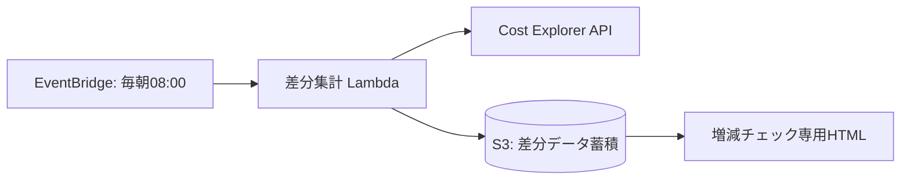

# AWSサービスごとのコスト増減チェック自動化メモ

## 1. 背景・目的
毎日のAWS利用料の中で、「どのサービスが前日や先週と比べて急に増えたか（消し忘れやリソース急増）」を、ブラウザを開けば一目で確認できるようにしたい。

## 2. 今どうやっているのか
- 気付いた人がたまに AWS Cost Explorer を開いて確認している
- サービスごとの差額を見るには、日付フィルターを変更してCSVをダウンロードし、手作業で引き算して比較している
- 結果として日々のチェックが定着せず、月末に想定外の請求が来てから気付くことがある

## 3. 解決できると考えている面倒なところ
- 毎回コンソールを開いてフィルター設定・CSV加工する手作業をなくす
- 「前日比」「前週同曜日比」の差分計算を自動化し、増減の比較にかかる時間を削減する

## 4. どう解決するのか（構想）
- 毎朝 EventBridge から Lambda を自動実行
- Cost Explorer API から直近のサービス別日次コストを取得
- サービスごとの差分（前日比・前週比）を計算して S3 に JSON として保存
- ブラウザを開くだけで、増減が一覧できる専用のHTML画面を用意する

## 5. 何が嬉しいのか（効果）
- 毎朝の確認がサッと終わり、リソース消し忘れや負荷急増に当日中に気付ける
- 汎用画面ではなく「自分たちが見たい差分」だけに特化しているため、判断がしやすい

## 6. ランニング費用（試算）
- Cost Explorer API 呼び出し: 約$0.01/回（月30回で約 $0.3/月）
- Lambda / S3: 無料枠〜数円レベル

## 7. 実装タスク（※検討事項の結果に応じて変更の可能性あり）
- **① 画面・データ設計（最優先）**:
  - 差分表示用HTMLのプロトタイプ作成
  - 最適なJSONスキーマの検討・定義
- **② 集計処理の実装**:
  - Cost Explorer APIからのデータ取得
  - 前日比・前週比の差分計算 ＆ JSON出力処理
- **③ インフラ構築・自動化**:
  - IaCコード作成 ＋ デプロイ（EventBridge, Lambda, S3）

## 8. 検討事項（チーム相談ポイント）
- **HTMLの配置場所とアクセス制御**
  - 背景：コスト情報は社外秘のため、一般公開は避ける必要がある
  - 検討ポイント：S3静的ホスティング（IP制限等）にするか、社内サーバーやローカル環境で動かすか、手軽さと安全性のバランスをどう取るか
- **S3データの取得方式とセキュリティ**
  - 背景：ブラウザからS3の非公開データを直接取得しようとするとCORSや認証が課題になる
  - 検討ポイント：バケットポリシーでのIP制限、署名付きURL、CLI経由での取得など、メンバーの利用手順に合わせた最適な連携方式をどうするか
